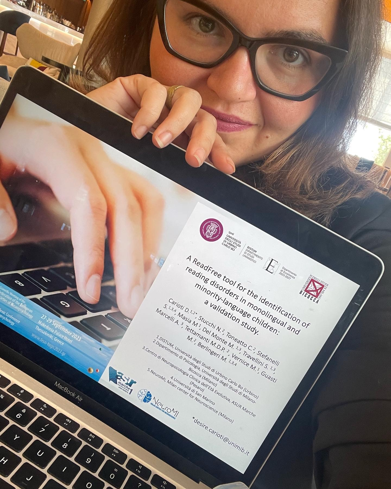

<a href="en/consulting.html">🇬🇧 Read in English</a>

:::: page-header
::: eyebrow
Per ricercatori, gruppi e organizzazioni
:::

<h1>Ricerca, consulenza e analisi dati</h1>

Dall’idea sperimentale all’interpretazione dei risultati: supporto metodologico per progetti di ricerca solidi e riproducibili.

::::

:::::: service-grid
::: service-card
<h3>Progettazione e metodologia</h3>

Disegni sperimentali, operazionalizzazione della domanda, definizione delle misure, campionamento, piani di analisi e supporto alla ricerca.

:::

::: service-card
<h3>Statistica e modellistica</h3>

Analisi in R, modelli misti, analisi multivariate, meta-analisi e approcci di machine learning.

:::

::: service-card
<h3>Psicometria e neuroimaging</h3>

Validazione di strumenti, analisi di dati comportamentali e di neuroimaging, supporto all’interpretazione.

:::
::::::

:::: feature

<h2>Esperienza scientifica applicata</h2>

Ho conseguito un dottorato di ricerca specializzandomi in particolar modo sulla psicometria e l'analisi dei dati, ho seguito formazioni specifiche su analisi di machine learning, modelli di mediazione e moderazioni, equazioni strutturali, meta-analisi comportamentali e statistica bayesiana. Ho collaborato all'ideazione e validazione di test per la valutazione del linguaggio, per lo screening e per il trattamento di condizioni neuropsicologiche cliniche.

<a href="research.qmd">Progetti di ricerca →</a>

::::

<a class="cta" href="contacts.qmd">Proponi un progetto</a>
