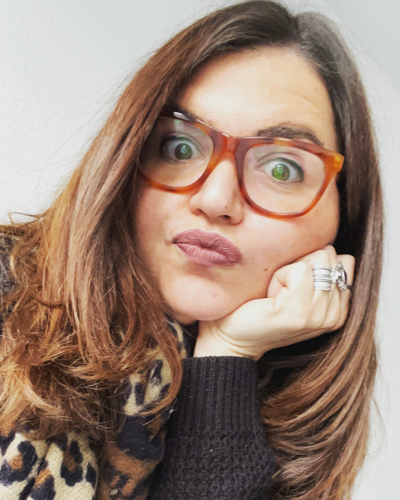
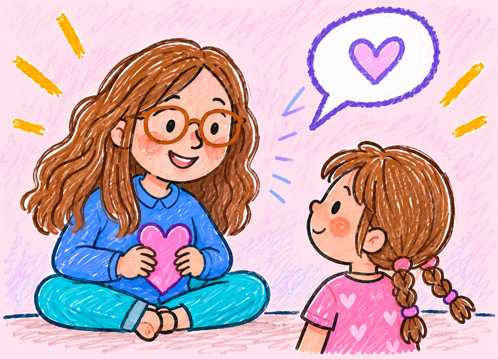
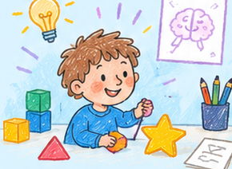
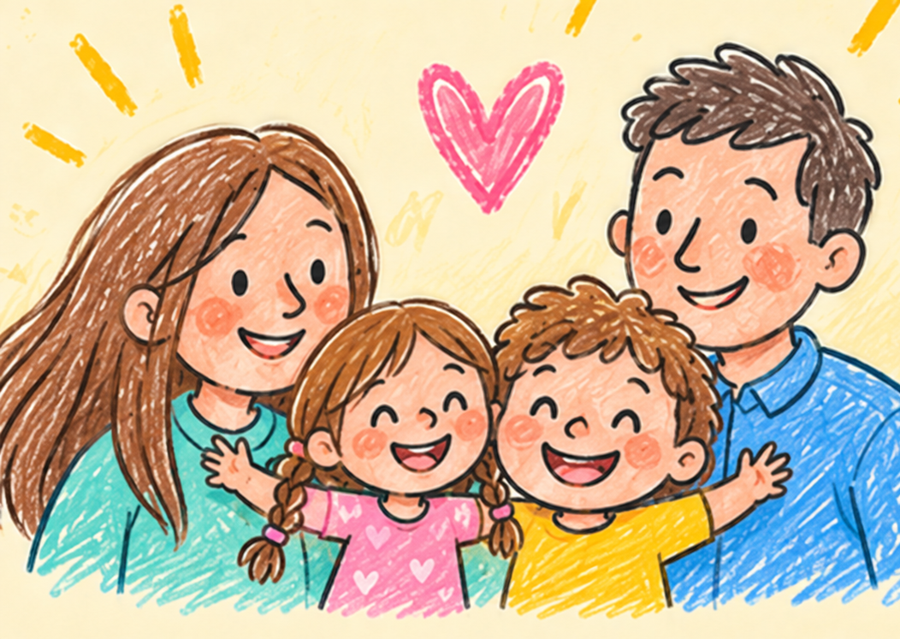

<a href="en/dr-desi.html">🇬🇧 Read in English</a>

::::: hero

::: eyebrow
Un angolo per i più piccoli
:::

<h1>Ciao, sono la Dottoressa [Desi!]{.desi-rainbow}</h1>

Mi piace scoprire come funzionano il cervello, le parole e le cose che impariamo ogni giorno. Nella ricerca incontro tanti bambini curiosi, pieni di domande e di idee.

Qui voglio raccontare il mio lavoro con un linguaggio semplice, anche per i più piccoli e per le loro famiglie.

:::::

:::::::: desi-services
## 🌈 Cosa posso fare per te?

:::::: desi-cards
::: {.desi-card .desi-pink}
{.desi-card-art}

### Ascoltarti e conoscerti

Possiamo parlare, giocare e scoprire insieme quello che senti, quello che ti piace e ciò che ti rende speciale.
:::

::: {.desi-card .desi-blue}
{.desi-card-art}

### Giocare e imparare

Possiamo fare giochi e piccole prove per capire se qualcosa a scuola ti sembra difficile e trovare insieme come aiutarti.
:::

::: {.desi-card .desi-yellow}
{.desi-card-art}

### Parlare con la tua famiglia

Posso ascoltare anche i tuoi genitori, per capire tutti insieme di cosa hai bisogno e come aiutarti a stare bene.
:::
::::::

::: desi-contact-cta
[Scrivimi insieme a un adulto](contacts.qmd){.cta}
:::
::::::::
