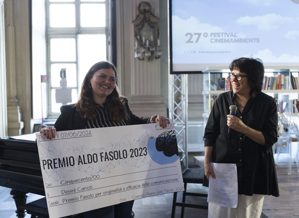
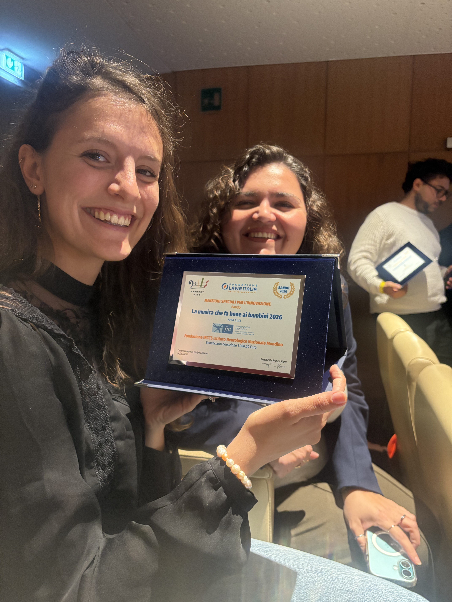

[🇮🇹 Leggi in italiano](../premi.html){.smallprint}

:::: page-header
::: eyebrow
Achievements and recognition
:::

<h1>Awards and recognition</h1>
::::

:::: feature

<h2>Aldo Fasolo Award 2023</h2>

<strong>“Aldo Fasolo 2023” Award</strong> from the InTo Brain Association, University of Turin, for originality and effectiveness in science communication. The award was presented in 2024.

<a href="https://www.intobrain.it/it/azione-3-premio-aldo-fasolo-2023-per-la-comunicazione-in-neuroscienze/bando-2023/i-vincitori-2023-2/" target="_blank" rel="noopener noreferrer">Associazione InTo Brain</a> ·
<a href="https://www.youtube.com/watch?v=xgYw3yoha_o" target="_blank" rel="noopener noreferrer">Project video</a> ·
<a href="https://bnews.unimib.it/blog/il-gioco-senza-parole-che-riconosce-i-dsa/" target="_blank" rel="noopener noreferrer">Interview on Bnews</a>

::::

::::: {.feature .lang-layout}
::: lang-text
        
<h2>Music That Benefits Children — 2026</h2>

  <strong>LANG Italia Foundation — Care Programme.</strong>
  Third place for the I.G.R.O.O.V.E. project at the
  IRCCS Mondino National Neurological Institute Foundation
  in Pavia, with a special mention for innovation.

:::

::: lang-photo
        

:::
:::::

:::::: service-grid
::: service-card
<h3>2024</h3>

<strong>Best Poster Award</strong> Research Day, Department of Psychology, University of Milano-Bicocca.

:::

::: service-card
<h3>2023</h3>

<strong>Honourable Mention for Best Poster</strong> CLASTA Conference, Pescara.

:::

::: service-card
<h3>2022</h3>

<strong>Best Poster Award</strong> Developmental Neuropsychology Conference, Bressanone.

:::
::::::
