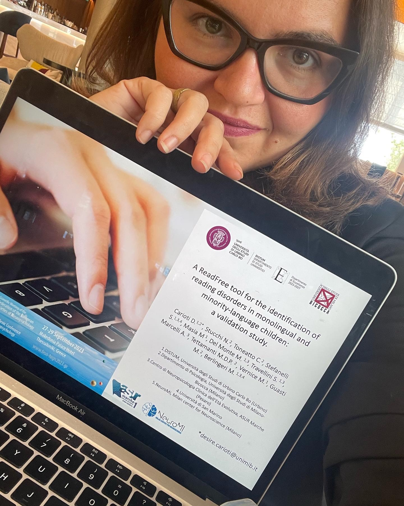

[🇮🇹 Leggi in italiano](../consulenza.html){.smallprint}

:::: page-header
::: eyebrow
For researchers, teams and organisations
:::

<h1>Research consulting and data analysis</h1>

From experimental ideas to interpreting results: methodological support for robust, reproducible research projects.

::::

:::::: service-grid
::: service-card
<h3>Research design and methodology</h3>

Experimental design, operationalising research questions, defining measures, sampling, analysis plans, and research support.

:::

::: service-card
<h3>Statistics and modelling</h3>

R-based analyses, mixed-effects models, multivariate methods, meta-analysis, and machine learning.

:::

::: service-card
<h3>Psychometrics and neuroimaging</h3>

Instrument validation, behavioural and neuroimaging data analysis, and support with interpretation.

:::
::::::

:::: feature

<h2>Applied research expertise</h2>

During my doctoral training I specialised in psychometrics and data analysis, and pursued additional training in machine learning, mediation and moderation models, structural equation modelling, behavioural meta-analysis, and Bayesian statistics. I have contributed to designing and validating tests for language assessment, screening, and the treatment of clinical neuropsychological conditions.

<a href="research.qmd">Research projects →</a>

::::

<a class="cta" href="contacts.qmd">Discuss a project</a>
