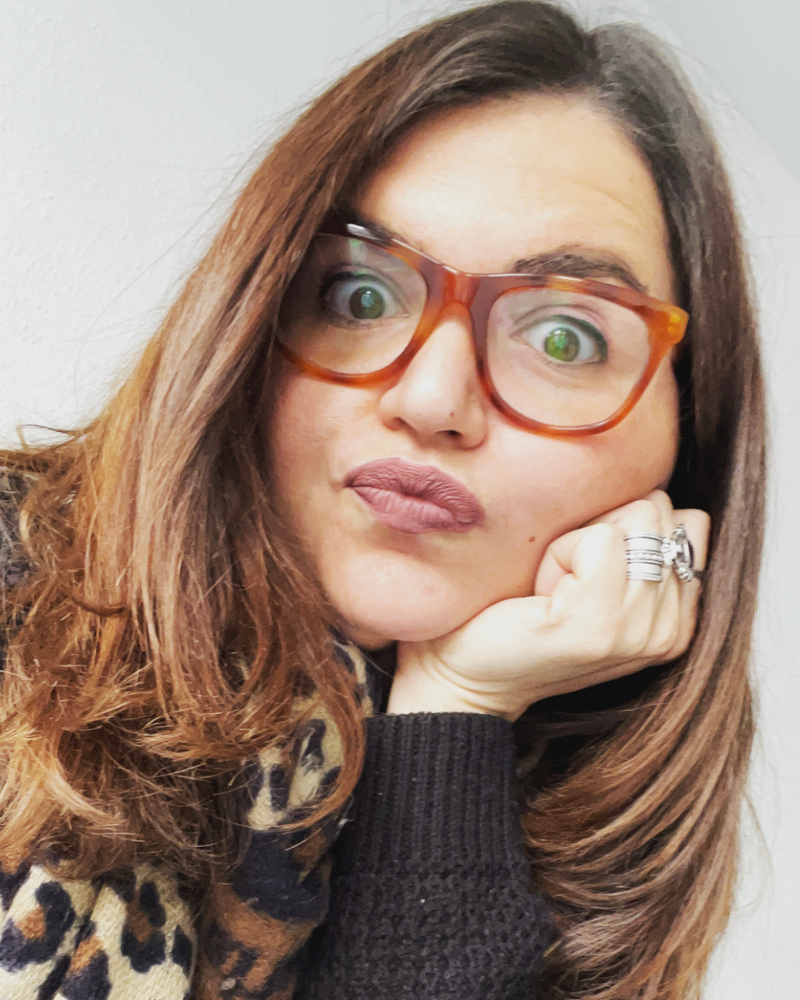
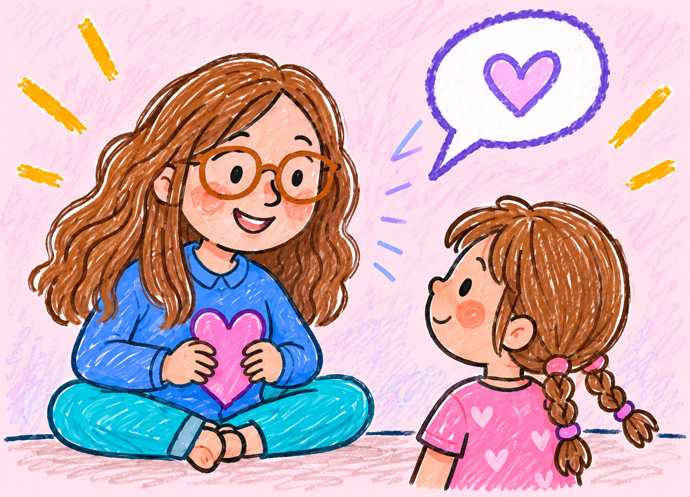
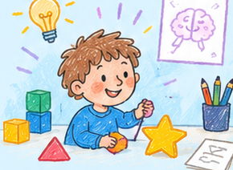
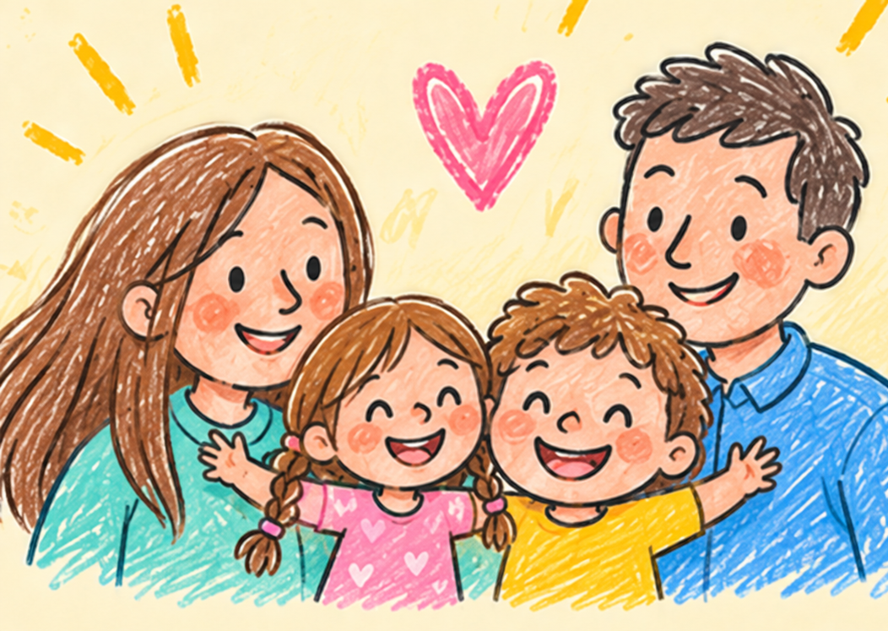

[🇮🇹 Leggi in italiano](../dottoressa-desi.html){.smallprint}

::::: hero

::: eyebrow
A corner for little ones
:::

<h1>Hi, I’m Dr [Desi!]{.desi-rainbow}</h1>

I love discovering how our brains work, how words work, and how we learn new things every day. In my research, I meet lots of curious children full of questions and ideas.

Here I want to tell you about my work in simple words, so that children and their families can understand it too.

:::::

:::::::: desi-services
## 🌈 How can I help you?

:::::: desi-cards
::: {.desi-card .desi-pink}
{.desi-card-art}

### Listen and get to know you

We can talk, play, and explore how you feel, what you like, and what makes you special.
:::

::: {.desi-card .desi-blue}
{.desi-card-art}

### Play and learn

We can play games and try little activities to understand if something at school feels tricky and find ways to help you.
:::

::: {.desi-card .desi-yellow}
{.desi-card-art}

### Talk with your family

I can listen to your parents too, so we can all work out what you need and how to help you feel good.
:::
::::::

::: desi-contact-cta
[Write to me with a grown-up](contacts.qmd){.cta}
:::
::::::::
