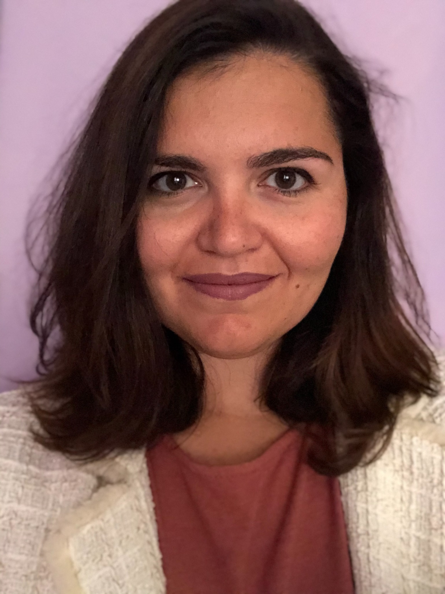
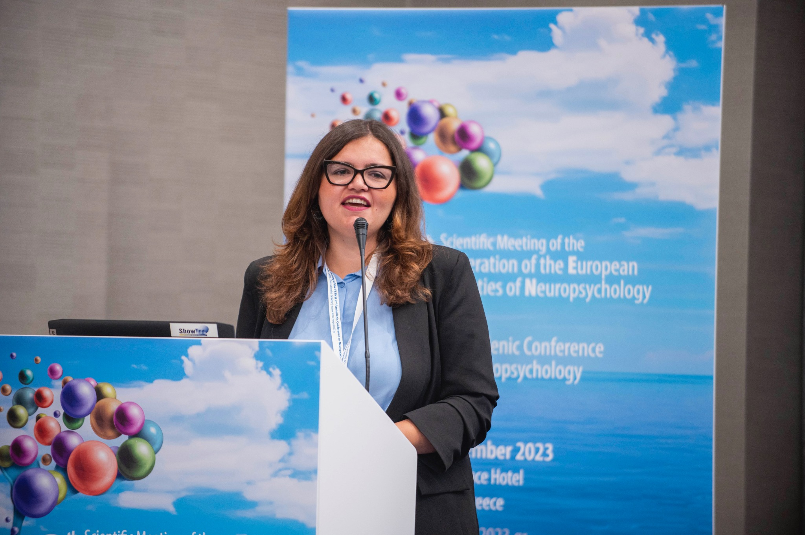
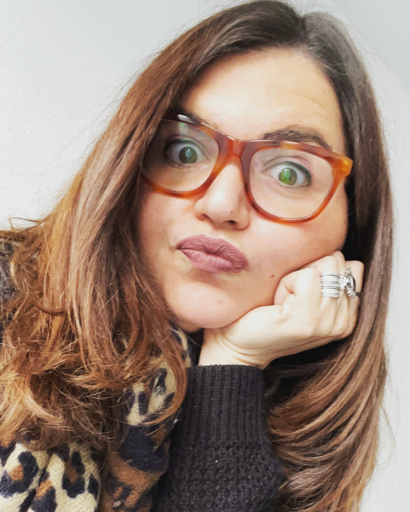
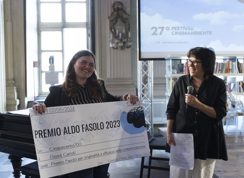

[🇮🇹 Leggi in italiano](../index.html){.smallprint}

:::::: hero

::: eyebrow
Psychology · Neuroscience · Research
:::

<h1>Explore, understand, support.</h1>

I am Desiré Carioti, a psychologist, trainee psychotherapist and PhD in psychology and cognitive neuroscience.

I work with individuals and families, collaborate on scientific projects, and share knowledge through teaching and training.

::: hero
<a class="cta" href="#servizi">Explore my services</a> <a class="cta secondary" href="contacts.qmd">Get in touch</a>
:::

::::::

::: eyebrow
Areas of practice
:::

<h2 id="servizi">Three areas of work, one evidence-informed approach</h2>

:::::: service-grid
::: service-card
<h3>Psychology and neuropsychology</h3>

Individual and group body-oriented psychotherapy, neuropsychological assessment, cognitive training, and consultations on learning and neurodevelopment.

<a href="psychology.qmd">Explore psychological services →</a>
:::

::: service-card
<h3>Research consulting and data analysis</h3>

Study design, data analysis, meta-analysis, and validation of psychological and clinical assessment tools.

<a href="consulting.qmd">Explore consulting services →</a>
:::

::: service-card
<h3>Training and science communication</h3>

Seminars, courses, and workshops for practitioners, researchers, teachers, schools, and organisations.

<a href="training.qmd">Explore training opportunities →</a>
:::
::::::

::::: feature

::: eyebrow
My background
:::

<h2>Bridging clinical practice and research</h2>

I earned my PhD in Human Studies (Psychology track) at the University of Urbino Carlo Bo and worked at the University of Milano-Bicocca on national and international projects investigating language, reading, learning, and cognitive neuroscience. I collaborate with the Carlo Besta Neurological Research Institute in Milan and the OltreLaMusica association in Senigallia.

<a href="research.qmd">Explore research projects →</a>

:::::

::::: {.feature .reverse}

::: eyebrow
A world to discover
:::

<h2>Dr Desi</h2>

A playful space for children and families, sharing the curiosity, play, and discoveries that are part of my work. What does it mean to do scientific research? How does our brain work? How can I help you? Let’s explore the world of the mind together!

<a href="dr-desi.qmd">Visit the page →</a>

:::::

::::: feature

::: eyebrow
Professional milestones
:::

<h2>Awards, books and publications</h2>

Scientific papers, book chapters, and awards highlight some of the milestones in my career.

<a href="publications.qmd">Publications →</a> · <a href="awards.qmd">Awards →</a>

:::::
