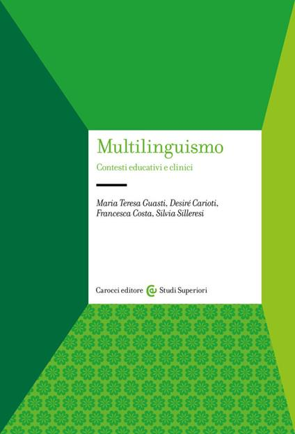
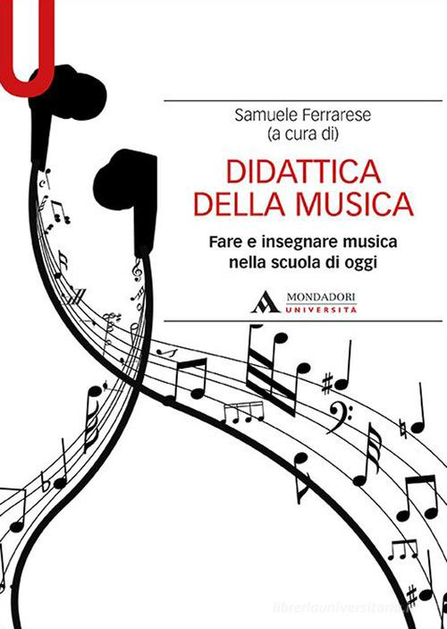

[🇮🇹 Leggi in italiano](../publications.html){.smallprint}

:::: page-header
::: eyebrow
Articles and book contributions
:::

<h1>Publications and books</h1>

My work on psychology, neuroscience, language, and learning.

::::

::: publication-profiles
<a class="cta"
     href="https://www.researchgate.net/profile/Desire-Carioti"
     target="_blank" rel="noopener noreferrer"> ResearchGate ↗ </a>

<a class="cta secondary"
     href="https://scholar.google.it/citations?user=uD8CBGUAAAAJ&hl=it"
     target="_blank" rel="noopener noreferrer"> Google Scholar ↗ </a>
:::

<h2>Book contributions</h2>

::::::: book-grid
:::: book

<h3>Multilinguismo. Contesti educativi e clinici</h3>

Carocci, 2023. Co-author of the book and author of the chapter <em>Bilingualism and developmental dyslexia</em>.

::::

:::: book

<h3>Didattica della musica</h3>

Mondadori Università, 2020. Author of the chapters <em>Music and the brain</em> e <em>Music and dyslexia</em>.

::::
:::::::

<h2>MY SCIENTIFIC PUBLICATIONS</h2>

1.  Carioti, D., Cancer, A., Ficosecco, C., Balestri, A., Antonietti, A., Stucchi, N., & Guasti, M. T. (2026). Anticipating the beat: rhythm and meter in developmental dyslexia. *Scientific Reports*. <https://doi.org/10.1038/s41598-026-70817-7>
2.  Saponaro, C., Carioti, D., & Guasti, M. T. (2026). Be precise if you must: Asymmetric patterns in the comprehension and production of distributivity across development. Applied Psycholinguistics. <https://doi.org/10.1017/S0142716426100757>
3.  Franca, M., Gramegna, C., Carioti., D., Levi Morenos, C., Sangalli, G., Perucca, L., Zago, S., Bolognini, N. Normative data and clinical usability of the brief examination of social abilities: a novel screening test for social cognition. Neurol Sci. 2026 Jun 15;47(7):567. <https://doi.org/10.1007/s10072-026-09173-3>.
4.  Stefanelli S., Carioti., D., Colombini E., Mularoni E., Zaghini G., Del Monte M., Travellini S., Savelli E., Berlingeri M., Stella G (2026). Il dettato delle 20 parole: uno strumento collettivo per l’identificazione del rischio di difficoltà ortografiche. Psicologia clinica dello sviluppo.
5.  Raminelli, L., Carioti., D., Guasti, M. (2026). ‘The More, the Better?’ An Experimental Investigation on the Role of Sentential Negation in the Acquisition of Italian Nessuno. FIRST LANGUAGE <https://doi.org/10.1177/01427237261422601>.
6.  Dal Farra, C., Gonzalez, A., Silleresi, S., Carioti, D., & Guasti, M. T. (2025). Sì and no: How Italian children and adults answer positive and negative polar questions. Language Acquisition, 1-35. <https://doi.org/10.1080/10489223.2025.2562194>
7.  Saponaro, C., Carioti, D., Riva, M., & Guasti, M. T. (2025). Reaching Meaning through Language: What can Children Tell Us about Distributivity?. Journal of Child Language, 1-21. <https://doi.org/10.1017/S0305000925000224>
8.  Carioti, D., Stefanelli, S., Giorgi, A., Masia, M. F., Del Pivo, G., Del Monte, M., ... & Berlingeri, M. (2024). The Daily Linguistic Practice Interview: A new instrument to assess language use and experience in minority language children and their effect on reading skills. Ampersand, 12, 100166. <https://doi.org/10.1016/j.amper.2024.100166>
9.  Carioti, D., Berlingeri, M., de Gregory, V., Vagni, M., Nerino, M., Pantalissi, M., & Pajardi, D. (2024). The Attitude Toward Prisoners scale: a revised short version standardized on Italians (ATP-iS). RASSEGNA ITALIANA DI CRIMINOLOGIA, 18(1), 59-68.
10. Carioti, D., Stucchi, N. A., Toneatto, C., Masia, M. F., Del Monte, M., Stefanelli, S., ... & Berlingeri, M. (2023). The ReadFree tool for the identification of poor readers: a validation study based on a machine learning approach in monolingual and minority-language children. Annals of Dyslexia, 73(3), 356-392. <https://doi.org/10.1007/s11881-023-00287-3>
11. Driemel, I., Hein, J., Carioti, D., Wünsch, J., Tsakali, V., Alexiadou, A., ... & Guasti, M. T. (2022). An experimental study on kind and generic readings across languages: bare plural vs. definite plural. In Proceedings of the Amsterdam Colloquium (pp. 360-366).
12. Taha, J., Carioti, D., Stucchi, N., Granocchio, E., Sarti, D., De Salvatore, M., & Guasti (2022). Identifying the risk of dyslexia in bilingual children: The potential of language-dependent and language-independent tasks. Front. Psychol., Sec. Language Sciences. <https://doi.org/10.3389/fpsyg.2022.935935>.
13. Di Palma, M., Carioti, D., Arcangeli, E., Rosazza, C., Ambrogini, P., Cuppini, R., ... & Berlingeri, M. (2022). The biased hand. Mouse-tracking metrics to examine the conflict processing in a race-implicit association test. PloS one, 17(7), e0271748.
14. Carioti D., Stucchi N., Toneatto C., Masia M.F., Broccoli M., Carbonari S., Travellini S., Del Monte M., Riccioni R., Marcelli A., Vernice M., Guasti M.T., Berlingeri M. (2022). Rapid Automatized Naming as a Universal Marker of Developmental Dyslexia in Italian Monolingual and Minority-Language Children. Front Psychol. 2022 Apr 7;13:783775. <https://doi.org/10.3389/fpsyg.2022.783775>.
15. Sacheli, L. M., Arcangeli, E., Carioti, D., Butterfill, S., & Berlingeri, M. (2022). Taking apart what brings us together: The role of action prediction, perspective-taking, and theory of mind in joint action. Quarterly Journal of Experimental Psychology, 75(7), 1228-1243.
16. Devoto, F., Carioti, D., Danelli, L., & Berlingeri, M. (2021). A meta-analysis of functional neuroimaging studies on developmental dyslexia across European orthographies: the ADOD model. Language, Cognition and Neuroscience, 1-30. <https://doi.org/10.1080/23273798.2021.1970200>
17. Carioti, D., Masia, M.F., Travellini, S., Berlingeri, M. (2021). Orthographic depth and developmental dyslexia: a meta- analytic study. Ann. of Dyslexia. <https://doi.org/10.1007/s11881-021-00226-0>
18. Carioti, D., Danelli, L., Guasti, M. T., Gallucci, M., Perugini, M., Steca, P., ... & Paulesu, E. (2019). Music Education at School: Too Little and Too Late? Evidence from a Longitudinal Study on Music Training in Preadolescents. Frontiers in Psychology, 10. <https://doi.org/10.3389/fpsyg.2019.02704>
19. Berlingeri M., Carioti D., Danelli L., Lo Gerfo E. (2018). As Time Goes by a rTMS Study on Age-Related Changes in Sentence Comprehension. Front. Aging Neurosci. 10:307. <https://doi.org/10.3389/fnagi.2018.00307>.
