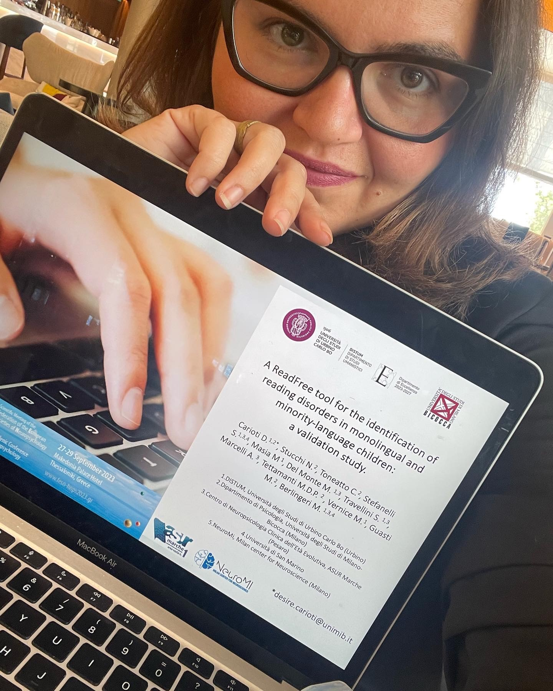
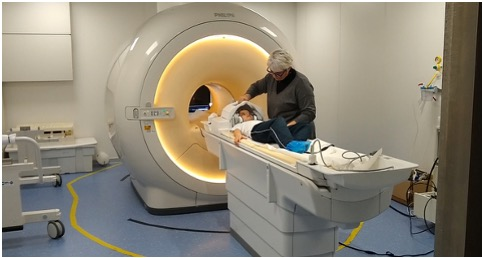
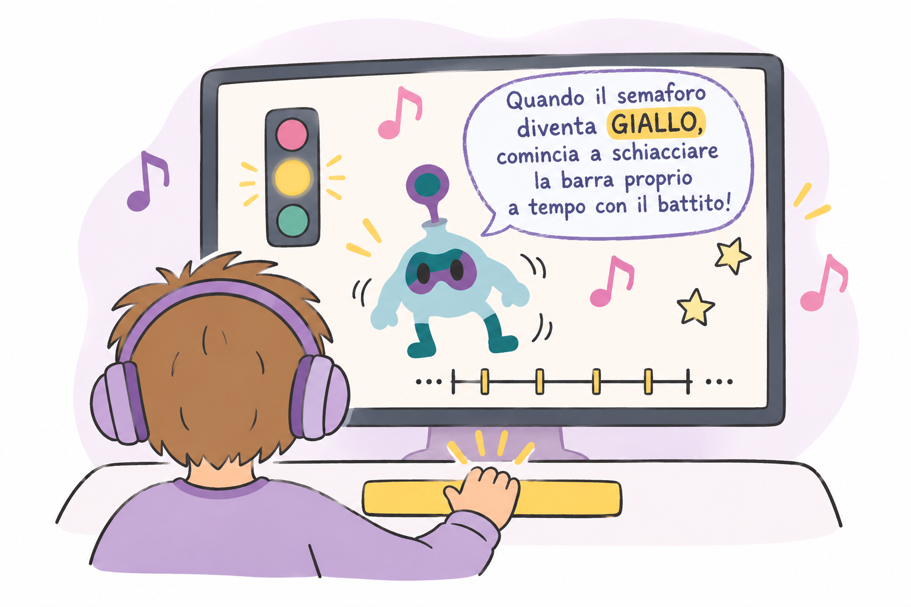
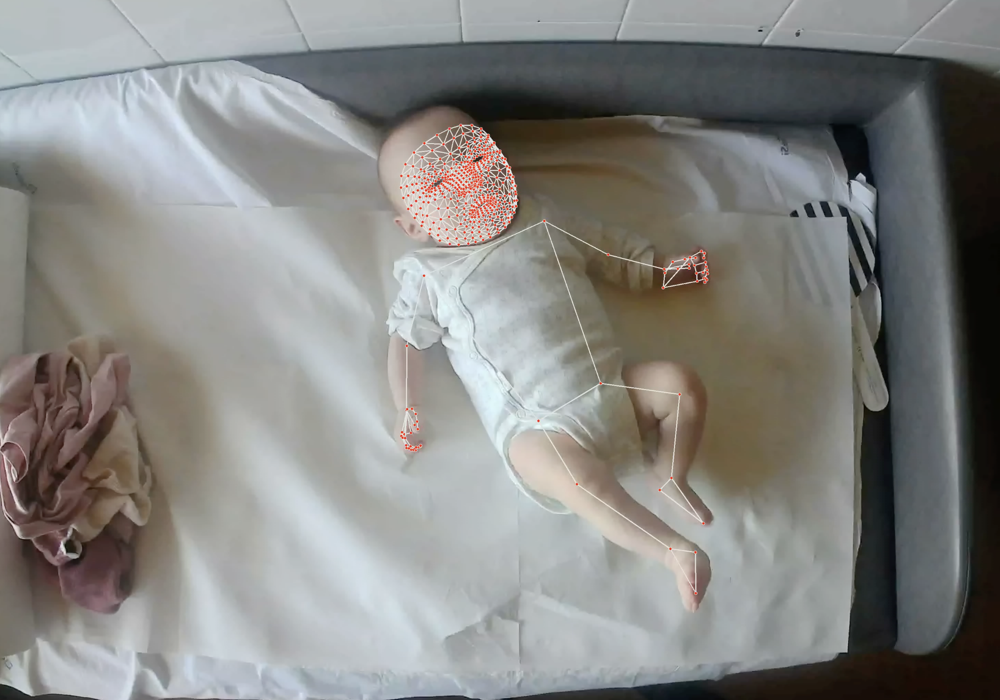
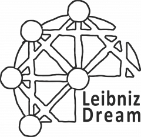
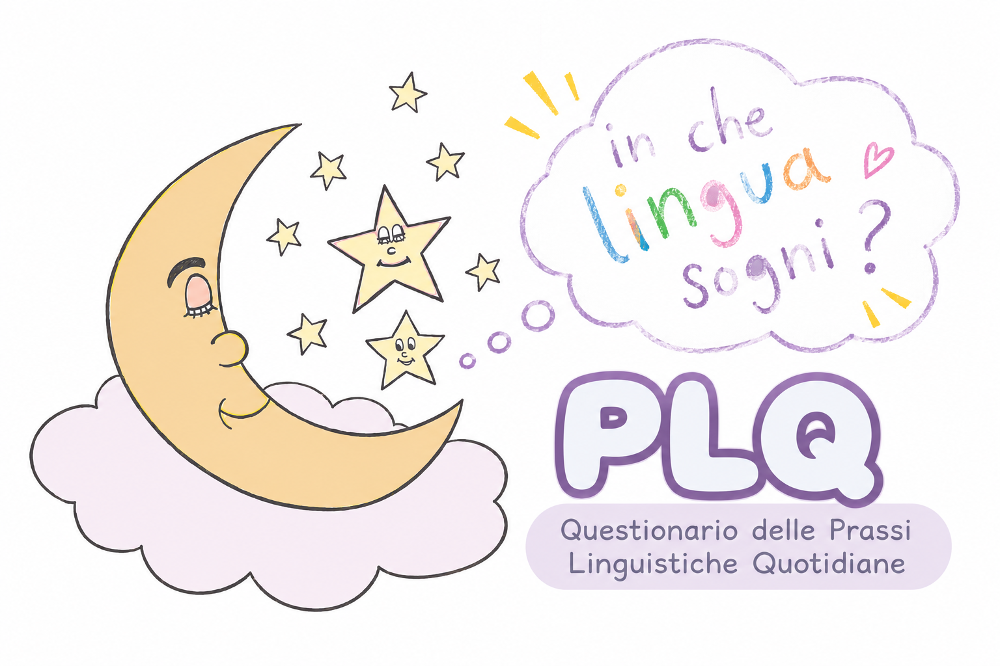

[🇮🇹 Leggi in italiano](../research.html){.smallprint}


:::: page-header
::: eyebrow
Research portfolio
:::

<h1>Research projects</h1>

<p class="lead">

I study the cognitive and neural processes involved in reading and language, with particular attention to rhythm and temporal prediction. My research has involved preschool and primary-school children, adolescents, and young adults. My primary training is in psychometrics and general psychology, complemented by experience in neuroimaging.

</p>
::::

:::: feature
{.readfree-photo}

<div>

<h2>MY RESEARCH AREAS</h2>

<p>

Investigating the acquisition and development of rhythmic, language, and cognitive skills.

Designing and validating paper-and-pencil and digital tools to assess cognitive skills related to learning and dyslexia risk, including among bilingual children.

Collaborations with the University of Urbino Carlo Bo, University of Milano-Bicocca, Politecnico di Milano, Carlo Besta Research Institute, TiCuro REPLY, and FifthIngenium

</p>

</div>
::::


<a class="cta" href="publications.qmd">View publications</a>

<!-- PROGETTI E COLLABORAZIONI -->

<section class="research-projects">

::: research-heading
[MY SCIENTIFIC WORK]{.eyebrow}

<h2>Research projects and collaborations</h2>

<p>From studying cognitive processes to developing assessment tools: selected research areas to which I have contributed.</p>
:::

<article class="research-project">

:::: research-visual
::: research-visual
```{=html}

```
:::
::::

:::::::::::::::::: research-description
[PSYCHOMETRICS · NEURODEVELOPMENT]{.eyebrow}

<h3>ReadFree</h3>

<p>Developing and validating tools to identify reading difficulties early through cognitive skills that are not strictly language-based.</p>

<p class="research-methods">

Psychometrics · Screening · Machine learning

</p>

</div>

</article>

<article class="research-project reverse">

:::: research-visual
::: research-visual
```{=html}

```
:::
::::

::::::::::::::: research-description
[COGNITIVE NEUROSCIENCE]{.eyebrow}

<h3>FREE-DD</h3>

<p>A longitudinal study of cognitive and neural markers of developmental dyslexia, with particular attention to family risk.</p>

<p class="research-methods">

Cognitive assessment · MRI · Longitudinal analyses

</p>

</div>

</article>

<article class="research-project">

:::: research-visual
::: research-visual
```{=html}

```
:::
::::

:::::::::::: research-description
[GENERAL PSYCHOLOGY]{.eyebrow}

<h3>Rhythm, music and language</h3>

<p>Experimental and meta-analytic studies of relationships among temporal processing, motor anticipation, language skills, and reading.</p>

<p class="research-methods">

Tapping · Synchronisation · Meta-analysis

</p>

</div>

</article>

<article class="research-project reverse">

:::: research-visual
::: research-visual
```{=html}

```
:::
::::

::::::::: research-description
[DEVELOPMENTAL PSYCHOLOGY]{.eyebrow}

<h3>IG.R.O.O.V.E.</h3>

<p>A scientific collaboration investigating rhythm processing and development in children born preterm.</p>

<p class="research-methods">

Cognitive development · Rhythm processing

</p>

</div>

</article>

<article class="research-project">

:::: research-visual
::: research-visual
```{=html}

```
:::
::::

:::::: research-description
[PSYCHOLOGY AND EXPERIMENTAL LINGUISTICS]{.eyebrow}

<h3>LeibnizDream</h3>

<p>Research conducted within an ERC Synergy project on the cognitive mechanisms of language acquisition.</p>

<p class="research-methods">

Experimental design · Behavioural analyses

</p>

</div>

</article>

<article class="research-project reverse">

:::: research-visual
::: research-visual
```{=html}

```
:::
::::

::: research-description
[LANGUAGE · LEARNING]{.eyebrow}

<h3>Bilingualism and reading</h3>

<p>Investigating links between language experience, reading development, and the early identification of learning difficulties.</p>

<p class="research-methods">

Psychometrics · Cognitive assessment

</p>

</div>

</article>

</section>
:::

:::::

:::::::

:::::::::

:::::::::::

:::::::::::::

:::::

:::::::

:::::::::

:::::::::::

:::::::::::::

:::::

:::::::

:::::::::

:::::::::::

:::::::::::::

:::::

:::::::

:::::::::

:::::::::::

:::::::::::::
::::::
:::::::::
::::::::::::
:::::::::::::::
::::::::::::::::::
