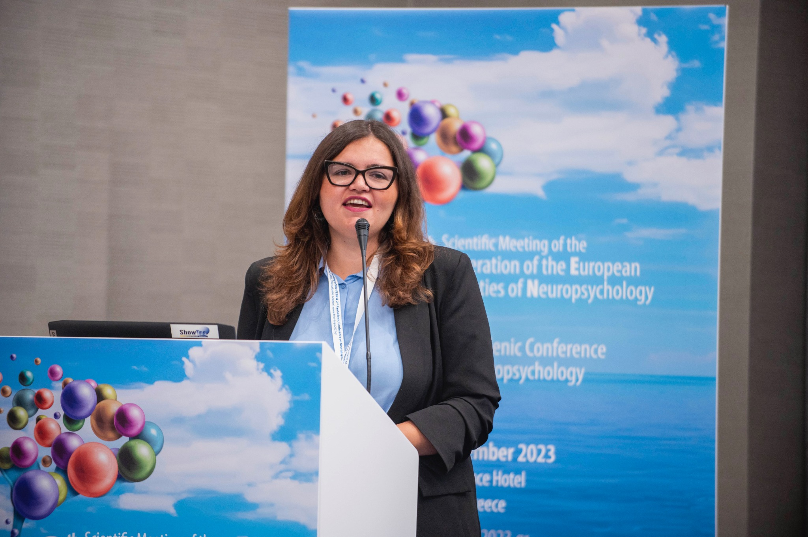

[🇮🇹 Leggi in italiano](../formazione.html){.smallprint}

:::: page-header
::: eyebrow
For schools, institutions, businesses and individuals
:::

<h1>Training and science communication</h1>

Sharing research means making it understandable, rigorous, and useful.

::::

:::::: service-grid
::: service-card
<h3>Neurodevelopment and learning</h3>

Specific learning disorders, bilingualism, language, cognitive functions, and assessment tools.

:::

::: service-card
<h3>Neuroscience and music</h3>

Rhythm, the brain, development, and relationships between musical experience and cognitive abilities.

:::

::: service-card
<h3>Research methods and statistics</h3>

Research design, data analysis, R, and critical appraisal of scientific literature.

:::
::::::

:::: feature

<h2>Teaching experience</h2>

I teach “Neuroscience of Music” in the Cognitive Sciences and Decision-Making programme at the University of Milan. I previously taught “Software and Statistical Analysis” and “Research Methodology” at the University of Urbino Carlo Bo.

I have delivered workshops and training for teachers across educational levels on learning disorders and the role of music in language disorders.

I design seminars, webinars, and workshops, both in person and online, for a range of audiences. Content can be tailored to schools, organisations, professional groups, and individual participants.

::::

<section class="training-offers" id="proposte-formative">

::: training-intro

Programmes and events

<h2>Training opportunities</h2>

Four areas and several formats: public science talks, hands-on workshops, and bespoke programmes for schools, institutions, and businesses. These are examples of available topics, not a schedule of confirmed events.

:::

::::: {#scuole .training-area}
::: training-area-heading
::: {.training-kicker}
01 · Schools and education professionals
:::

<h3>Neurodevelopment and learning</h3>

Seminars and workshops for teachers, educators, schools, and neurodevelopment professionals.

:::

::: training-cards
<article class="training-card">

<h4>Rhythm and learning: what are the prospects for specific learning disorders?</h4>

The relationship between temporal processing, rhythmic skills, language, and reading. Current evidence, research limitations, and the potential of rhythm-based interventions.

Seminar · Workshop

</article>

<article class="training-card">

<h4>Recognising learning difficulties early</h4>

Early risk indicators, the development of cognitive and language skills, and recognising difficulties before they become entrenched at school.

Seminar · Teacher training

</article>

<article class="training-card">

<h4>Bilingualism, migration, and language difficulties</h4>

Language development in bilingual children and children from migrant backgrounds: interpreting individual differences without automatically treating them as disorders.

Seminar · Workshop

</article>
:::

<a class="training-link" href="contacts.qmd">Enquire about training for your school →</a>
:::::

::::: {#neuroscienze-per-tutti .training-area}
::: training-area-heading
::: {.training-kicker}
02 · General public and enthusiasts
:::

<h3>Neuroscience for everyone</h3>

Accessible science talks for anyone interested in learning about the brain, music, and human behaviour, with no specialist background required.

:::

::: training-cards
<article class="training-card">

<h4>The musical brain</h4>

Why does music move us? Perception, emotion, memory, movement, and anticipation in musical experience.

Public webinar · In-person talk

</article>

<article class="training-card">

<h4>Does music make us smarter?</h4>

Exploring myths, scientific findings, and open questions about how musical experience affects cognitive abilities.

Public webinar

</article>

<article class="training-card">

<h4>Why do we move to the beat?</h4>

Rhythm, movement, and synchronisation: how the brain anticipates events and coordinates our actions with music and other people.

Webinar · Interactive session

</article>
:::

<a class="training-link" href="contacts.qmd">Ask about upcoming events →</a>
:::::

::::: {#ricerca .training-area}
::: training-area-heading
::: {.training-kicker}
03 · Researchers and practitioners
:::

<h3>Research methodology and data analysis</h3>

Practical training for students, PhD candidates, researchers, psychologists, and professionals interested in quantitative research.

:::

::: training-cards
<article class="training-card">

<h4>From research question to statistical model</h4>

Study design, variable selection, model choice, and interpretation of findings.

Hands-on workshop

</article>

<article class="training-card">

<h4>Data analysis with R</h4>

A practical introduction to regression, mixed-effects models, and data visualisation, using examples from psychological research.

Practical lab · Modular course

</article>

<article class="training-card">

<h4>Critically reading a scientific paper</h4>

How to assess methods, analyses, results, and conclusions, distinguishing evidence from interpretation.

Webinar · Seminar

</article>
:::

<a class="training-link" href="contacts.qmd">Plan specialist training with me →</a>
:::::

::::: {#aziende .training-area}
::: training-area-heading
::: {.training-kicker}
04 · Businesses and organisations
:::

<h3>Neuroscience, the body, and wellbeing at work</h3>

Educational and experiential sessions exploring attention, stress, emotions, and body awareness. Available as seminars or in-person workshops, including combined programmes.

:::

::: training-cards
<article class="training-card">

<h4>The brain under pressure</h4>

An interactive seminar on attention, working memory, cognitive load, and stress, with brief optional body-awareness exercises.

Seminar · Online or in person

</article>

<article class="training-card">

<h4>The body at work</h4>

An experiential workshop inspired by bioenergetic principles: grounding, breathing, movement, and bodily awareness to explore connections between tension, emotion, and self-awareness.

Body-based workshop · In person

</article>

<article class="training-card">

<h4>Rhythm, movement, and connection</h4>

Rhythm and synchronisation activities to explore coordination, mutual listening, and group interaction through experience.

Experiential workshop · In person

</article>
:::

Body-based workshops are educational activities, not psychotherapy. Participation in exercises is voluntary and can be adapted to participants’ needs.

<a class="training-link" href="contacts.qmd">Request a proposal for your organisation →</a>
:::::

</section>

::: training-final-cta
<h2>Shall we plan an event?</h2>

Every programme can be tailored in duration, depth, audience, and delivery format. Both one-off events and multi-session programmes are possible.

<a class="cta" href="contacts.qmd">Plan an event</a>
:::

