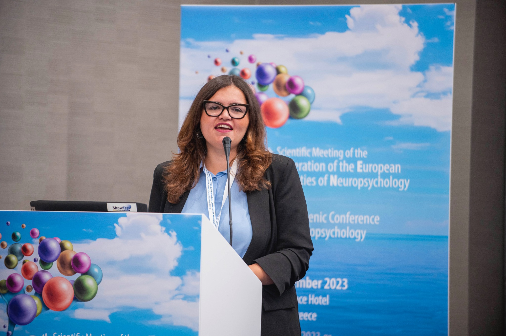

<p class="smallprint">

<a href="en/training.html">🇬🇧 Read in English</a>

</p>

:::: page-header
::: eyebrow
Per scuole, enti, aziende e privati
:::

<h1>Formazione e divulgazione</h1>

<p class="lead">

Condividere la ricerca significa renderla comprensibile, rigorosa e utilizzabile.

</p>
::::

:::::: service-grid
::: service-card
<h3>Neurosviluppo e apprendimento</h3>

<p>DSA, bilinguismo, linguaggio, funzioni cognitive e strumenti di valutazione.</p>
:::

::: service-card
<h3>Neuroscienze e musica</h3>

<p>Ritmo, cervello, sviluppo e relazioni tra esperienza musicale e abilità cognitive.</p>
:::

::: service-card
<h3>Metodologia e statistica</h3>

<p>Progettazione della ricerca, analisi dei dati, R e lettura critica della letteratura.</p>
:::
::::::

:::: feature


<div>

<h2>Esperienza didattica</h2>

<p>Insegno «Neuroscienze della Musica» presso il corso di laurea in Scienze Cognitive e Processi Decisionali dell’Università degli Studi di Milano. Ho insegnato «Software e Analisi Statistica» e «Metodologia della Ricerca» presso l’Università degli Studi di Urbino Carlo Bo.</p>

<p>Ho condotto workshop e attività formative per docenti delle scuole di ogni ordine e grado sui disturbi dell’apprendimento e sul ruolo della musica nei disturbi del linguaggio.</p>

<p>Progetto seminari, webinar e laboratori, in presenza e online, per pubblici diversi. I contenuti possono essere adattati alle esigenze di scuole, organizzazioni, gruppi di professionisti e singoli partecipanti.</p>

</div>
::::

<section class="training-offers" id="proposte-formative">

::: training-intro
        
<p class="training-kicker">Percorsi e incontri</p>
<h2>Proposte formative</h2>
<p>Quattro aree, con formati differenti: incontri divulgativi aperti al pubblico, workshop pratici e percorsi progettati su richiesta per scuole, enti e aziende. Le proposte qui presentate sono esempi di contenuti disponibili, non un calendario di eventi già programmati.</p>

:::

::: {#scuole .training-area}
       
<div class="training-area-heading">
  <p class="training-kicker">01 · Scuole e professionisti dell’educazione</p>
  <h3>Neurosviluppo e apprendimento</h3>
  <p>Seminari e workshop per insegnanti, educatori, scuole e professionisti del neurosviluppo.</p>
</div>
<div class="training-cards">
  <article class="training-card">
    <h4>Ritmo e apprendimento: quali prospettive per i DSA?</h4>
    <p>Il rapporto tra elaborazione temporale, abilità ritmiche, linguaggio e lettura. Evidenze disponibili, limiti della ricerca e potenzialità degli interventi basati sul ritmo.</p>
    <p class="training-format">Seminario · Workshop</p>
  </article>
  <article class="training-card">
    <h4>Riconoscere precocemente le difficoltà di apprendimento</h4>
    <p>Indicatori precoci di rischio, sviluppo delle abilità cognitive e linguistiche e osservazione delle difficoltà prima che si consolidino nel percorso scolastico.</p>
    <p class="training-format">Seminario · Formazione docenti</p>
  </article>
  <article class="training-card">
    <h4>Bilinguismo, migrazione e difficoltà di linguaggio</h4>
    <p>Lo sviluppo linguistico nei bambini bilingui e con background migratorio: come interpretare le differenze individuali senza confonderle automaticamente con un disturbo.</p>
    <p class="training-format">Seminario · Workshop</p>
  </article>
</div>
<a class="training-link" href="contacts.qmd">Richiedi un percorso per la tua scuola →</a>

:::

::::: {#neuroscienze-per-tutti .training-area}
::: training-area-heading
::: {.training-kicker}
02 · Pubblico e appassionati
:::

<h3>Neuroscienze per tutti</h3>

<p>Incontri divulgativi per chi desidera conoscere meglio il cervello, la musica e il comportamento umano, senza necessità di una formazione specialistica.</p>
:::

::: training-cards
<article class="training-card">

<h4>Il cervello musicale</h4>

<p>Perché la musica ci coinvolge? Percezione, emozioni, memoria, movimento e anticipazione nell’esperienza musicale.</p>

<p class="training-format">

Webinar divulgativo · Incontro dal vivo

</p>

</article>

<article class="training-card">

<h4>La musica ci rende più intelligenti?</h4>

<p>Un viaggio tra miti, risultati scientifici e domande ancora aperte sugli effetti dell’esperienza musicale sulle abilità cognitive.</p>

<p class="training-format">

Webinar divulgativo

</p>

</article>

<article class="training-card">

<h4>Perché andiamo a tempo?</h4>

<p>Ritmo, movimento e sincronizzazione: come il cervello anticipa gli eventi e coordina le nostre azioni con la musica e con gli altri.</p>

<p class="training-format">

Webinar · Incontro interattivo

</p>

</article>
:::

<a class="training-link" href="contacts.qmd">Chiedi informazioni sui prossimi incontri →</a>
:::::

::::: {#ricerca .training-area}
::: training-area-heading
::: {.training-kicker}
03 · Ricercatori e professionisti
:::

<h3>Metodologia della ricerca e analisi dei dati</h3>

<p>Formazione pratica per studenti, dottorandi, ricercatori, psicologi e professionisti interessati alla ricerca quantitativa.</p>
:::

::: training-cards
<article class="training-card">

<h4>Dalla domanda di ricerca al modello statistico</h4>

<p>Disegno dello studio, scelta delle variabili, selezione dei modelli e interpretazione dei risultati.</p>

<p class="training-format">

Workshop pratico

</p>

</article>

<article class="training-card">

<h4>Analisi dei dati con R</h4>

<p>Introduzione operativa a regressioni, modelli misti e visualizzazione dei dati, con esempi applicati alla ricerca psicologica.</p>

<p class="training-format">

Laboratorio · Corso modulare

</p>

</article>

<article class="training-card">

<h4>Leggere criticamente un articolo scientifico</h4>

<p>Come valutare metodi, analisi, risultati e conclusioni, distinguendo le evidenze dalle interpretazioni.</p>

<p class="training-format">

Webinar · Seminario

</p>

</article>
:::

<a class="training-link" href="contacts.qmd">Progettiamo una formazione specialistica →</a>
:::::

::::: {#aziende .training-area}
::: training-area-heading
::: {.training-kicker}
04 · Aziende e organizzazioni
:::

<h3>Neuroscienze, corpo e benessere al lavoro</h3>

<p>Proposte formative ed esperienziali dedicate al rapporto tra attenzione, stress, emozioni e consapevolezza corporea. Disponibili come seminari o laboratori in presenza, anche in percorsi integrati.</p>
:::

::: training-cards
<article class="training-card">

<h4>Il cervello sotto pressione</h4>

<p>Un seminario interattivo su attenzione, memoria di lavoro, carico cognitivo e stress, con brevi esperienze facoltative di consapevolezza corporea.</p>

<p class="training-format">

Seminario · Online o in presenza

</p>

</article>

<article class="training-card">

<h4>Il corpo al lavoro</h4>

<p>Laboratorio esperienziale ispirato ai principi della bioenergetica: grounding, respirazione, movimento e ascolto corporeo per esplorare il rapporto tra tensioni, emozioni e consapevolezza di sé.</p>

<p class="training-format">

Laboratorio corporeo · In presenza

</p>

</article>

<article class="training-card">

<h4>Ritmo, movimento e connessione</h4>

<p>Attività di ritmo e sincronizzazione per esplorare in modo esperienziale coordinazione, ascolto reciproco e interazione di gruppo.</p>

<p class="training-format">

Workshop esperienziale · In presenza

</p>

</article>
:::

<p class="training-note">

I laboratori corporei sono attività formative, non interventi psicoterapeutici. La partecipazione agli esercizi è volontaria e adattabile alle esigenze dei partecipanti.

</p>

<a class="training-link" href="contacts.qmd">Richiedi una proposta per la tua organizzazione →</a>
:::::

</section>

::: training-final-cta
<h2>Progettiamo un incontro?</h2>

<p>Ogni proposta può essere adattata per durata, livello di approfondimento, destinatari e modalità di svolgimento. È possibile organizzare incontri singoli o percorsi articolati in più appuntamenti.</p>

<a class="cta" href="contacts.qmd">Organizziamo un incontro</a>
:::

```{=html}
<style>
/* Stili circoscritti alla pagina Formazione: non modificano il resto del sito. */
.training-offers { margin: 4rem 0 2.5rem; }
.training-intro { max-width: 760px; margin-bottom: 2.6rem; }
.training-intro h2 { margin-top: .35rem; }
.training-kicker { font-size: .8rem; letter-spacing: .09em; text-transform: uppercase; font-weight: 700; color: #88648e; margin-bottom: .5rem; }
.training-area { margin: 0 0 3.8rem; }
.training-area-heading { max-width: 800px; margin-bottom: 1.35rem; }
.training-area-heading h3 { margin: .15rem 0 .6rem; }
.training-cards { display: grid; grid-template-columns: repeat(3, minmax(0, 1fr)); gap: 1.1rem; }
.training-card { display: flex; flex-direction: column; min-width: 0; padding: 1.4rem; border: 1px solid rgba(132, 94, 141, .22); border-radius: 16px; background: rgba(166, 124, 169, .055); }
.training-card h4 { font-size: 1.12rem; line-height: 1.35; margin: 0 0 .7rem; font-weight: 700; }
.training-card p { margin: 0 0 .85rem; }
.training-card .training-format { margin-top: auto; margin-bottom: 0; padding-top: .6rem; font-size: .82rem; font-weight: 650; color: #88648e; }
.training-link { display: inline-block; margin-top: 1.1rem; font-weight: 650; }
.training-note { max-width: 850px; font-size: .88rem; opacity: .8; margin-top: 1rem; }
.training-final-cta { max-width: 820px; margin: 3.5rem 0 2rem; }
.training-final-cta .cta { display: inline-block; margin-top: .6rem; }
@media (max-width: 950px) { .training-cards { grid-template-columns: repeat(2, minmax(0, 1fr)); } }
@media (max-width: 650px) { .training-cards { grid-template-columns: 1fr; } .training-offers { margin-top: 2.5rem; } .training-card { padding: 1.15rem; } }
</style>
```
