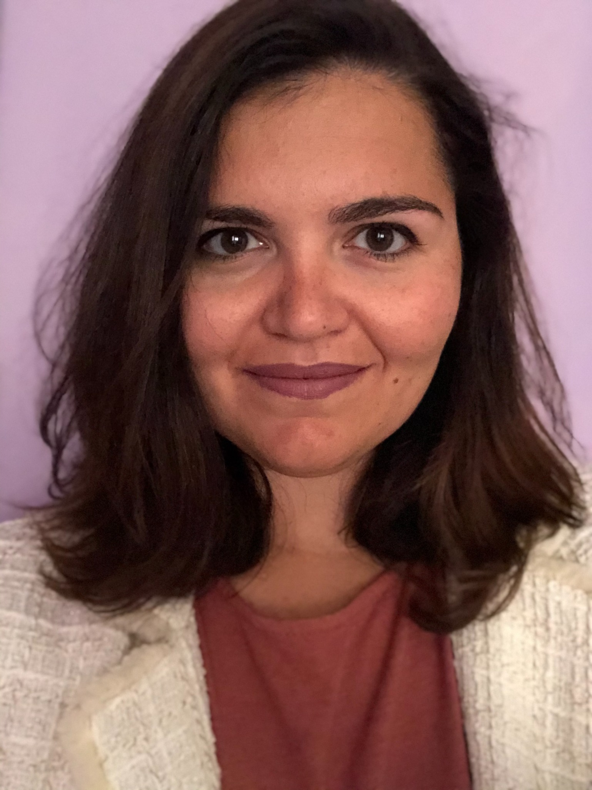
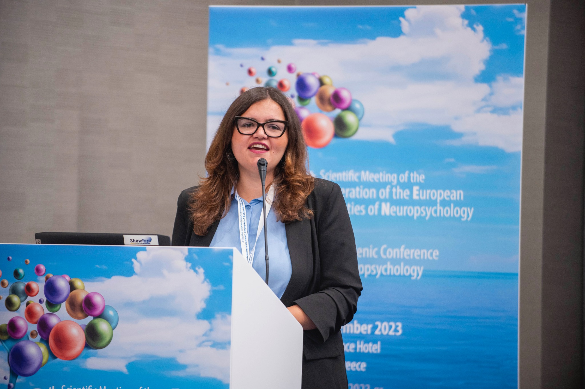
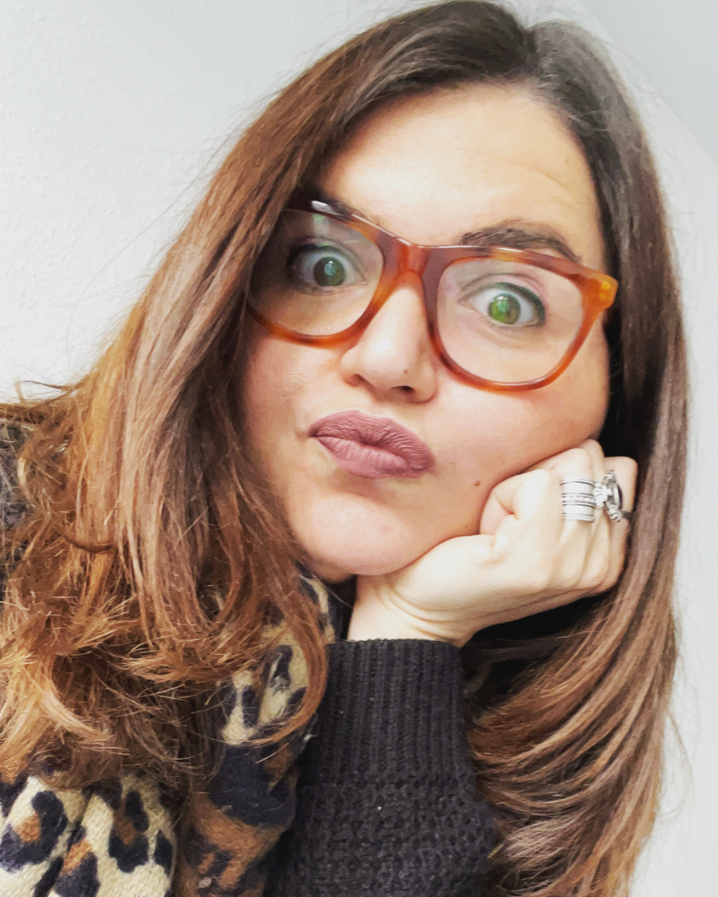
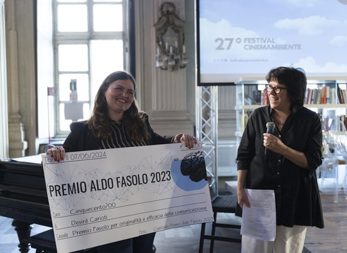

<a href="en/index.html">🇬🇧 Read in English</a>

:::::: hero

::: eyebrow
Psicologia · Neuroscienze · Ricerca
:::

<h1>Conoscere, comprendere, accompagnare.</h1>

Sono Desiré Carioti, psicologa, psicoterapeuta in formazione e Dottore di Ricerca in psicologia e neuroscienze cognitive.

Lavoro con persone e famiglie, collaboro a progetti scientifici e condivido conoscenze attraverso la formazione.

::: hero
<a class="cta" href="#servizi">Scopri i servizi che offro</a> <a class="cta secondary" href="contacts.qmd">Contattami</a>
:::

::::::

::: eyebrow
Ambiti professionali
:::

<h2 id="servizi">Tre modi di lavorare, un approccio fondato sulla scienza</h2>

:::::: service-grid
::: service-card
<h3>Psicologia e neuropsicologia</h3>

Psicoterapia a orientamento corporeo individuale e di gruppo, valutazione neuropsicologica, training cognitivo e consulenze per l’apprendimento e il neurosviluppo.

<a href="psicologia.qmd">Scopri i percorsi →</a>
:::

::: service-card
<h3>Ricerca, consulenza e analisi dati</h3>

Progettazione di studi, analisi dei dati, meta-analisi e validazione di strumenti psicologici e clinici,.

<a href="consulenza.qmd">Scopri le consulenze →</a>
:::

::: service-card
<h3>Formazione e divulgazione</h3>

Seminari, corsi e workshop per professionisti, ricercatori, insegnanti, scuole e organizzazioni.

<a href="formazione.qmd">Scopri la formazione →</a>
:::
::::::

::::: feature

::: eyebrow
Il mio percorso
:::

<h2>Tra clinica e ricerca</h2>

Ho conseguito il dottorato in Studi Umanistici, curriculum Psicologia, all’Università degli studi di Urbino Carlo Bo e ho lavorato presso l'Università degli Studi di Milano-Bicocca a progetti nazionali e internazionali dedicati a linguaggio, lettura, apprendimento e neuroscienze cognitive. Collaboro con l'I.R.C.C.S. Neurologico Carlo Besta (MI) e con l'associazione OltreLaMusica di Senigallia.

<a href="research.qmd">Esplora i progetti →</a>

:::::

::::: {.feature .reverse}

::: eyebrow
Un mondo da scoprire
:::

<h2>La Dottoressa Desi</h2>

Uno spazio più leggero, dedicato ai bambini e alle famiglie, per raccontare la curiosità, il gioco e la scoperta che accompagnano il mio lavoro. Che cosa significa fare ricerca scientifica? Come funziona il nostro cervello? Che cosa posso fare io per te? Scopriamo insieme il mondo della mente!

<a href="dottoressa-desi.qmd">Entra nella pagina →</a>

:::::

::::: feature

::: eyebrow
I miei traguardi professionali
:::

<h2>Riconoscimenti, libri e pubblicazioni</h2>

Articoli scientifici, contributi a libri e riconoscimenti raccontano alcuni risultati del mio percorso.

<a href="publications.qmd">Pubblicazioni →</a> · <a href="premi.qmd">Premi →</a>

:::::
