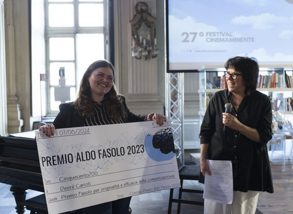
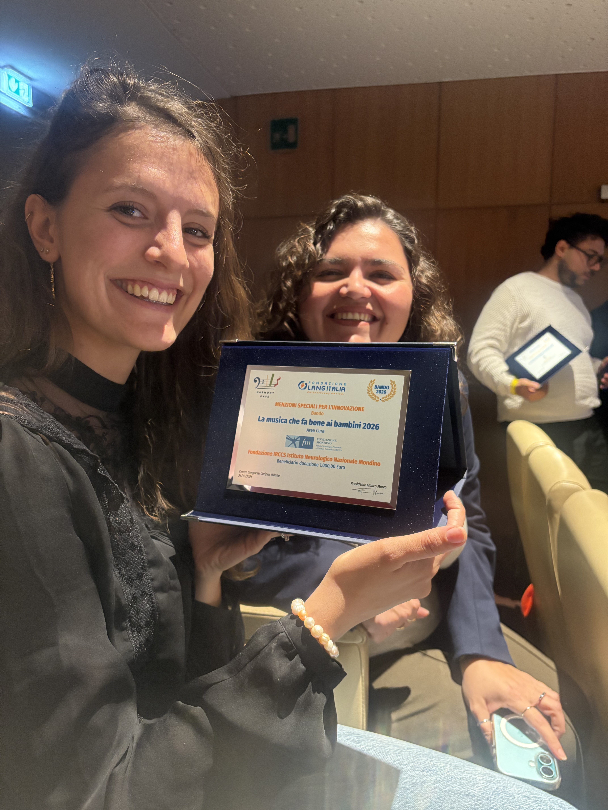

<a href="en/awards.html">🇬🇧 Read in English</a>

:::: page-header
::: eyebrow
Risultati e riconoscimenti
:::

<h1>Premi e riconoscimenti</h1>
::::

:::: feature

<h2>Premio Aldo Fasolo 2023</h2>

<strong>Premio “Aldo Fasolo 2023”</strong> dell’Associazione InTo Brain, Università di Torino, per l’originalità e l’efficacia della comunicazione scientifica. Riconoscimento conferito nel 2024.

<a href="https://www.intobrain.it/it/azione-3-premio-aldo-fasolo-2023-per-la-comunicazione-in-neuroscienze/bando-2023/i-vincitori-2023-2/" target="_blank" rel="noopener noreferrer">Associazione InTo Brain</a> ·
<a href="https://www.youtube.com/watch?v=xgYw3yoha_o" target="_blank" rel="noopener noreferrer">Il video del progetto</a> ·
<a href="https://bnews.unimib.it/blog/il-gioco-senza-parole-che-riconosce-i-dsa/" target="_blank" rel="noopener noreferrer">Intervista su Bnews</a>

::::

::::: {.feature .lang-layout}
::: lang-text
        
<h2>La Musica che fa bene ai bambini — 2026</h2>

  <strong>Fondazione LANG Italia — Area Cura.</strong>
  Terzo posto per il progetto I.G.R.O.O.V.E. della
  Fondazione IRCCS Istituto Neurologico Nazionale Mondino
  di Pavia, con menzione speciale per l'innovazione.

:::

::: lang-photo
        

:::
:::::

:::::: service-grid
::: service-card
<h3>2024</h3>

<strong>Best Poster Award</strong> Research Day, Dipartimento di Psicologia, Università di Milano-Bicocca.

:::

::: service-card
<h3>2023</h3>

<strong>Menzione miglior poster</strong> Giornate CLASTA, Pescara.

:::

::: service-card
<h3>2022</h3>

<strong>Best Poster Award</strong> Giornate di Neuropsicologia dell’Età Evolutiva, Bressanone.

:::
::::::
