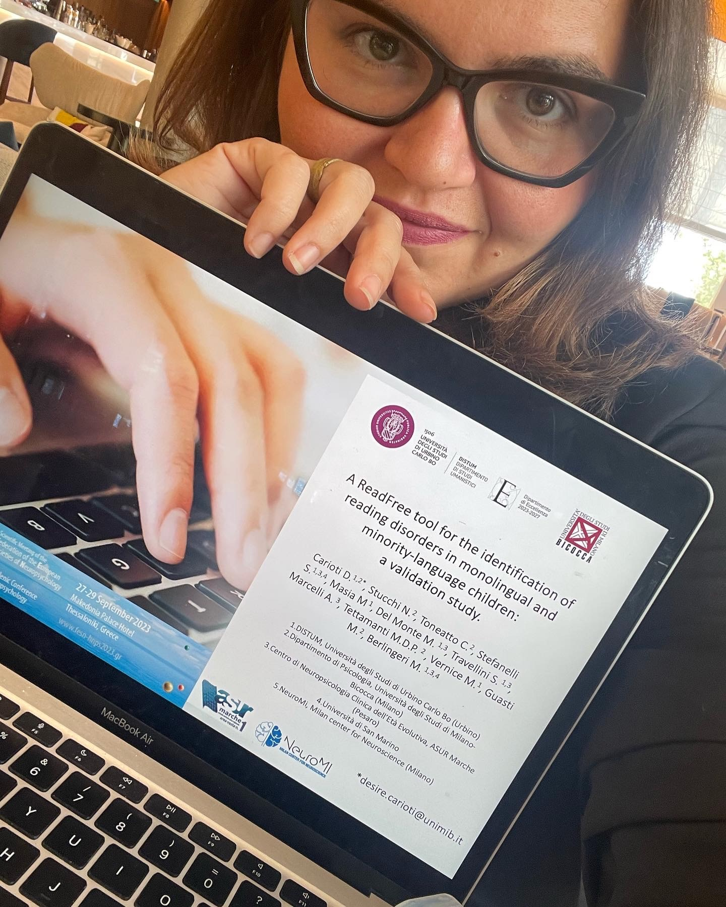
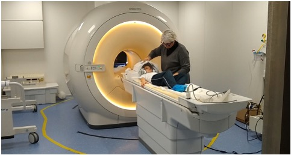
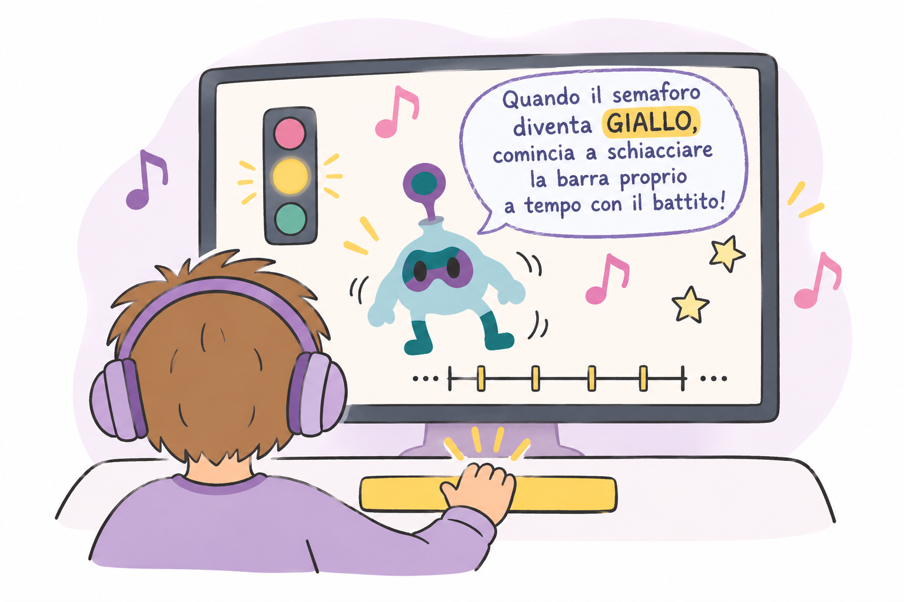
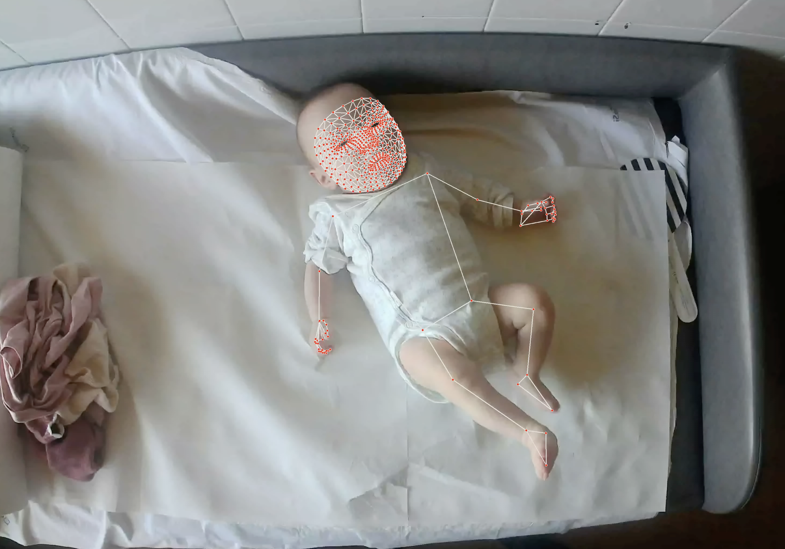
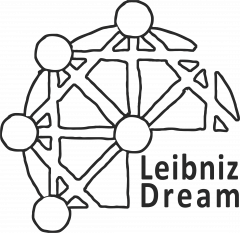
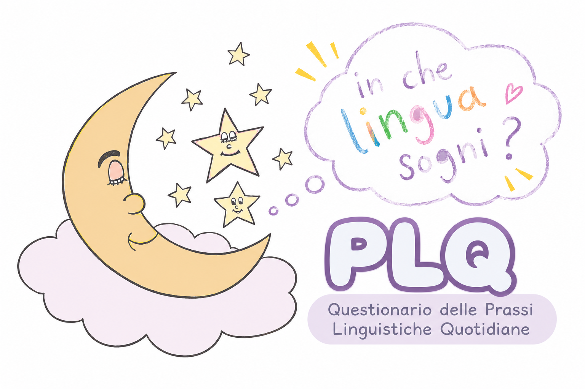

::: {.smallprint}
[🇬🇧 Read in English](en/research.html)
:::

:::: {.page-header}
::: {.eyebrow}
Research portfolio
:::

# Progetti di ricerca

::: {.lead}
Studio i processi cognitivi e neurali coinvolti nella lettura e nel linguaggio, con particolare attenzione al ritmo e alla predizione temporale. Negli anni ho condotto ricerche su bambini della scuola primaria e dell'asilo, adolescenti e giovani adulti. Mi sono principalmente formata in Psicometria e Psicologia Generale, ma ho fatto esperienze anche nell'ambito del neuroimaging.
:::
::::

:::: {.feature}
{.readfree-photo}

::: {}
## LE MIE LINEE DI RICERCA

Studio dell'acquisizione e dello sviluppo delle abilità ritmiche, linguistiche e cognitive.

Progettazione e validazione di strumenti carta-matita e digitali per lo studio di abilità cognitive legate all’apprendimento e al rischio di dislessia, anche in bambini bilingui.

Attività in collaborazione con Università degli Studi di Urbino Carlo Bo, Università degli Studi di Milano-Bicocca, Politecnico di Milano, I.R.C.C.S. Carlo Besta, TiCuro REPLY, FifthIngenium
:::
::::

[Leggi le pubblicazioni](publications.qmd){.cta}

<!-- PROGETTI E COLLABORAZIONI -->

::::: {.research-projects}

::: {.research-heading}
[IL MIO LAVORO SCIENTIFICO]{.eyebrow}

## Progetti e collaborazioni di ricerca

Dallo studio dei processi cognitivi allo sviluppo di strumenti di valutazione: alcune delle principali linee di ricerca a cui ho contribuito.
:::

:::: {.research-project}
::: {.research-visual}
{.research-image}
:::
::: {.research-description}
[PSICOMETRIA · NEUROSVILUPPO]{.eyebrow}

### ReadFree

Sviluppo e validazione di strumenti per identificare precocemente le difficoltà di lettura attraverso abilità cognitive non strettamente linguistiche.

::: {.research-methods}
Psicometria · Screening · Machine learning
:::
:::
::::

:::: {.research-project .reverse}
::: {.research-visual}
{.research-image}
:::
::: {.research-description}
[NEUROSCIENZE COGNITIVE]{.eyebrow}

### FREE-DD

Studio longitudinale dei marcatori cognitivi e neurali della dislessia evolutiva, con particolare attenzione al rischio familiare.

::: {.research-methods}
Valutazione cognitiva · MRI · Analisi longitudinali
:::
:::
::::

:::: {.research-project}
::: {.research-visual}
{.research-image}
:::
::: {.research-description}
[PSICOLOGIA GENERALE]{.eyebrow}

### Ritmo, musica e linguaggio

Studi sperimentali e meta-analitici sulle relazioni tra elaborazione temporale, anticipazione motoria, competenze linguistiche e lettura.

::: {.research-methods}
Tapping · Sincronizzazione · Meta-analisi
:::
:::
::::

:::: {.research-project .reverse}
::: {.research-visual}
{.research-image}
:::
::: {.research-description}
[PSICOLOGIA DELLO SVILUPPO]{.eyebrow}

### IG.R.O.O.V.E.

Collaborazione scientifica dedicata allo studio dell'elaborazione ritmica e dello sviluppo nei bambini nati pretermine.

::: {.research-methods}
Sviluppo cognitivo · Elaborazione ritmica
:::
:::
::::

:::: {.research-project}
::: {.research-visual}
{.research-image}
:::
::: {.research-description}
[PSICOLOGIA e LINGUISTICA SPERIMENTALE]{.eyebrow}

### LeibnizDream

Attività di ricerca nell'ambito di un progetto ERC Synergy dedicato ai meccanismi cognitivi dell'acquisizione del linguaggio.

::: {.research-methods}
Disegni sperimentali · Analisi comportamentali
:::
:::
::::

:::: {.research-project .reverse}
::: {.research-visual}
{.research-image}
:::
::: {.research-description}
[LINGUAGGIO · APPRENDIMENTO]{.eyebrow}

### Bilinguismo e lettura

Studio delle relazioni tra esperienza linguistica, sviluppo delle abilità di lettura e identificazione precoce delle difficoltà di apprendimento.

::: {.research-methods}
Psicometria · Valutazione cognitiva
:::
:::
::::

:::::
